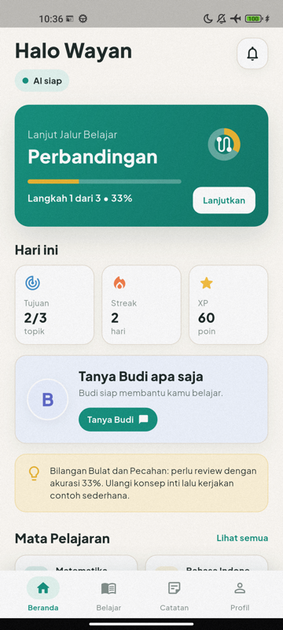
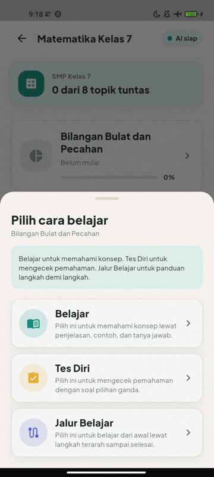
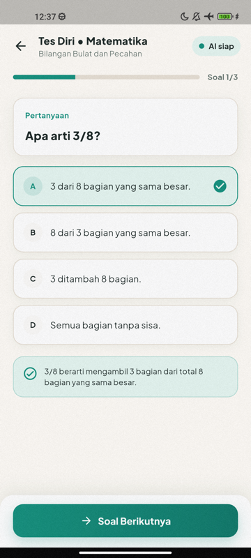
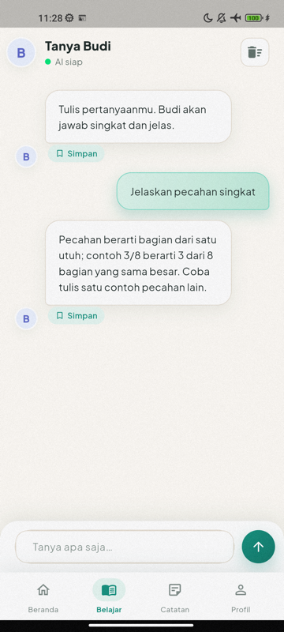

# Encourise

Encourise is an offline-first AI tutoring app for Indonesian K-12 students.
The Android app runs Google's Gemma 4 E2B model on the phone itself, so students
can learn with the AI tutor, Budi, without an internet connection. When the
phone reaches WiFi, learning data syncs to Supabase, and teachers review it in a
web dashboard.

The app interface is in Bahasa Indonesia.

<p>
  
  
  
  
</p>

## Why

Many students in Indonesia have limited or unreliable internet access. Most AI
tutors need a connection to a cloud model. Encourise moves the model onto the
device, so tutoring keeps working offline and student conversations stay on the
phone.

## Try the App

Download the Android APK from the
[latest release](https://github.com/iwyusdaz/encourise-app/releases/latest).
The release page has install steps and the link to the AI model, a separate
2.6 GB download.

## Features

**Student app (Android, Flutter)**

- On-device tutoring with Gemma 4 E2B through LiteRT-LM (Google AI Edge).
- Learning modes:
  - Belajar: Socratic explanation and Q&A.
  - Tes Diri: multiple-choice self-test.
  - Jalur Belajar: a resumable 3-step guided path.
  - Tanya Budi: free chat.
- Curriculum-aligned topics for Matematika, IPA, IPS, Bahasa Indonesia and
  Bahasa Inggris.
- Adaptive difficulty, weak-topic detection, streaks and XP.
- Learner memory: short summaries of each student's strengths and gaps, fed
  into later prompts.
- Saved notes from Budi's answers.
- Smart reminders with notification deep links into a quiz, guided path or
  tutoring session.
- Local SQLite storage with a sync queue that pushes to Supabase on WiFi.

**Teacher dashboard (Next.js)**

- Teacher login through Supabase Auth.
- Class overview with student status, session counts and average accuracy.
- Weak-topic heatmap across a class.
- Student pages with learner memory, session history, notes and weak topics.

## Tech Stack

| Area | Tools |
| --- | --- |
| Mobile | Flutter, Dart, Kotlin (platform channel to LiteRT-LM), SQLite (`sqflite`) |
| On-device AI | Gemma 4 E2B (`.litertlm`), LiteRT-LM with MTP speculative decoding |
| Web | Next.js 16, React 19, TypeScript, Tailwind CSS 4, shadcn/ui |
| Backend | Supabase (Postgres, Auth, row-level security) |

## My Role

I designed and built Encourise on my own: product scope, learning design, the
Flutter app, the native LiteRT-LM integration, prompt design for Budi, the
Supabase schema and the teacher dashboard.

## Repository Structure

```text
.
├── mobile/     Flutter student app (Android)
├── web/        Next.js teacher dashboard
├── backend/    Supabase SQL migrations
└── docs/       Design notes and screenshots
```

## Running Locally

### Mobile app

Requirements: Flutter SDK (Dart `^3.11.4`), Android SDK, and an Android phone
or emulator.

```bash
cd mobile
flutter pub get
flutter test
flutter run
```

The app needs the Gemma model file, which is about 2.6 GB and not included in
this repository. Download `gemma-4-E2B-it.litertlm` from
[litert-community/gemma-4-E2B-it-litert-lm](https://huggingface.co/litert-community/gemma-4-E2B-it-litert-lm)
and put it in the phone's Downloads folder. The app finds it automatically,
or you can push it with ADB:

```bash
adb push gemma-4-E2B-it.litertlm \
  /sdcard/Android/data/com.encourise.encourise_mobile/files/
```

Cloud sync is optional. To turn it on, copy `mobile/env.example.json` to
`mobile/env.json`, fill in your Supabase project values, and run:

```bash
flutter run --dart-define-from-file=env.json
```

Without these values the app runs fully offline.

### Teacher dashboard

```bash
cd web
npm install
npm run dev   # http://localhost:3000
```

Create `web/.env.local`:

```bash
NEXT_PUBLIC_SUPABASE_URL=<your-supabase-url>
NEXT_PUBLIC_SUPABASE_ANON_KEY=<your-supabase-anon-key>
```

### Database

The schema is in `backend/supabase/migrations/001_initial.sql`. Apply it to a
Supabase project before using sync or the dashboard.

## Release Builds

```bash
cd mobile
flutter build apk --release --dart-define-from-file=env.json
```

Release signing reads `mobile/android/key.properties` and a keystore file. Both
are private and are not in this repository.

## Copyright

© 2026 I Wayan Usada. All rights reserved. The code is public for viewing; it
is not licensed for reuse or redistribution.
